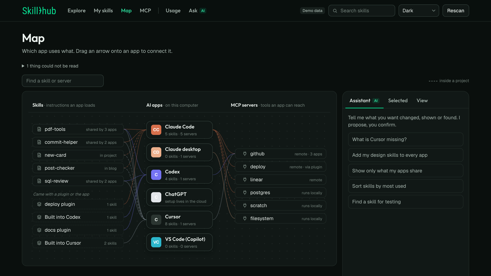
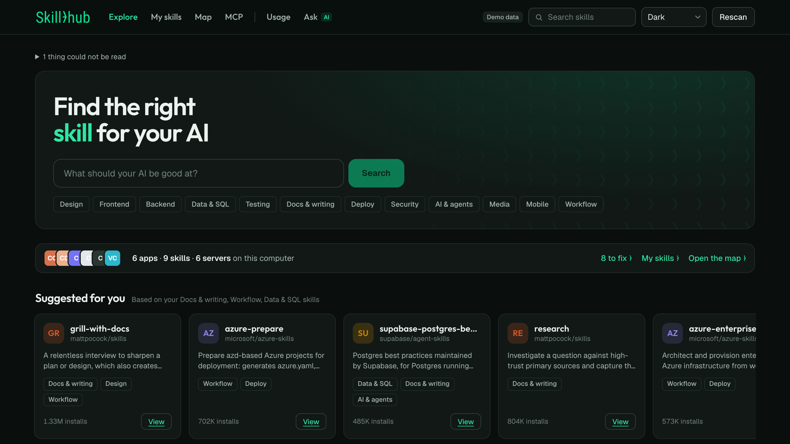
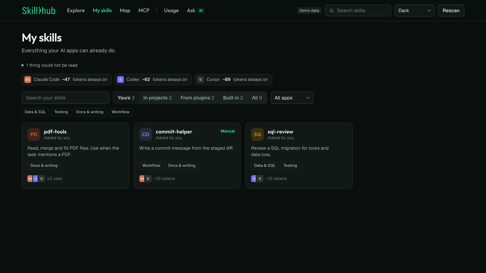
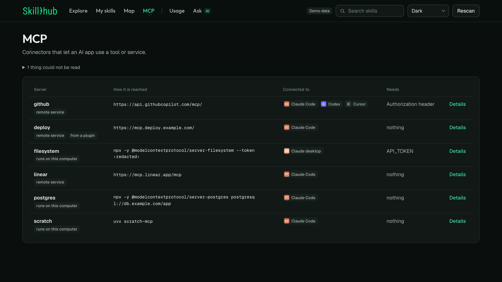
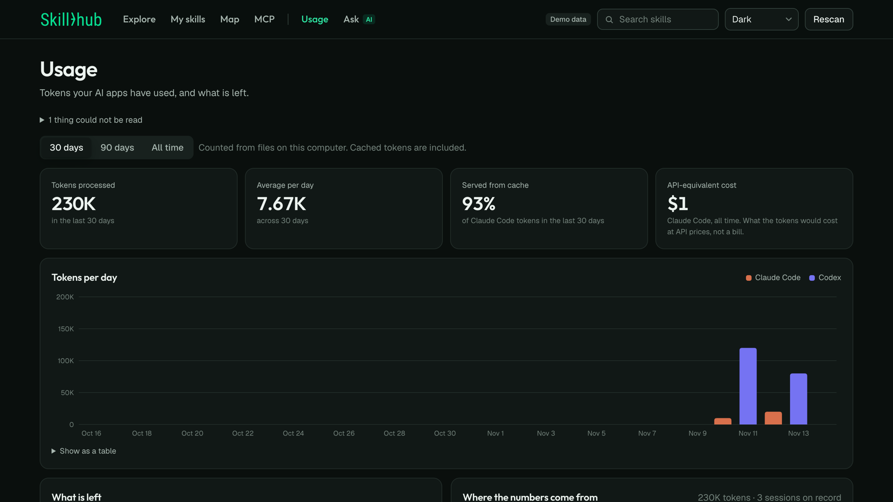
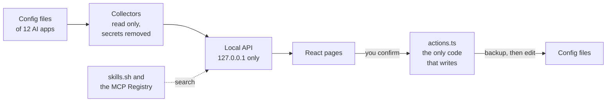
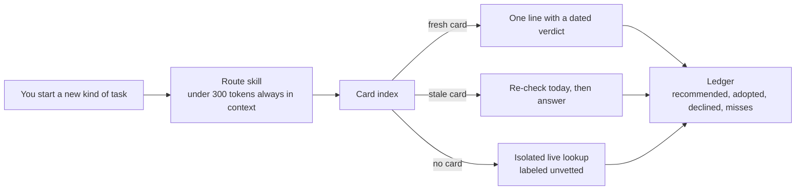

<h1 align="center">Skillhub</h1>

<p align="center">
  <b>See every skill and MCP server your AI apps have, find the ones you are missing, and connect them with one drag.</b>
</p>

<p align="center">
  <a href="https://github.com/hu-bill/Skillhub/actions/workflows/check.yml"></a>
  
  
  
</p>

<p align="center">
  <a href="#try-it-in-two-minutes">Try it in two minutes</a> ·
  <a href="#what-you-get">What you get</a> ·
  <a href="#how-it-works">How it works</a> ·
  <a href="#check-our-claims">Check our claims</a> ·
  <a href="#repository-map">Repository map</a>
</p>

<p align="center">
  
</p>

## The problem

A developer today runs several AI apps side by side: Claude Code, Codex, Cursor, a chat app or two. Each one keeps its skills and MCP servers in its own folders and config files. So nobody can answer three simple questions:

- What can each of my AI apps actually do right now?
- What does that cost me in tokens before I type a single word?
- Is there an existing skill or server that already does the task I am about to start?

## What we built

Skillhub answers those questions with two parts that share one idea: **use what already exists before adding anything new.**

| Part | Where | What it does |
| :- | :- | :- |
| **Skillhub dashboard** | [`dashboard/`](dashboard/) | A local web page that reads the config of 12 AI apps on your computer and draws what is connected to what. You can search two public registries, and connect or disconnect a skill or server with a drag. Nothing changes until you confirm. |
| **Wayfinder router** | [`pi-package/`](pi-package/) for [Pi](https://github.com/earendil-works/pi), [`plugin/`](plugin/) for Claude Code | A skill that runs inside your coding agent. When you start a new kind of work it checks a small set of dated decision cards and tells you, in one line, whether a built-in feature, a package or a working method fits better than the default. Often the answer is "nothing to add". |

## Try it in two minutes

You need Node 22.13 or newer. This runs the dashboard on invented data, so it shows nothing about your own machine and cannot change anything:

```bash
git clone https://github.com/hu-bill/Skillhub.git
cd Skillhub/dashboard
npm install
npm run demo
```

Open http://127.0.0.1:5177 and follow this path:

1. **Explore**: search for a skill, or pick a topic chip. Suggestions come from the topics your own skills lean toward.
2. **My skills**: click a card to see which apps load the skill and what it costs in always-on tokens.
3. **Map**: see which app uses which skill and which MCP server. On your own data you drag an arrow onto an app to connect it.
4. **MCP**: every server, how it is reached, and which apps have it. Secret values are never shown, only their names.
5. **Usage**: tokens per day by app, by model and by project.

To run it on your own setup, use `npm run dev` instead of `npm run demo`. It only reads until you ask for a change, and each change first shows the exact file it edits or the command it runs.

The Ask tab and the assistant on the map use Google Gemini and stay off until you add your own key. The steps are in [`dashboard/README.md`](dashboard/README.md#the-gemini-assistant).

## What you get

<table>
  <tr>
    <td width="50%"><br><b>Explore.</b> Search skills.sh and the official MCP Registry, with suggestions that fit what you already use.</td>
    <td width="50%"><br><b>My skills.</b> Every skill you have, where it came from, which apps load it and how often it is used.</td>
  </tr>
  <tr>
    <td width="50%"><br><b>MCP.</b> Every distinct server, how it is reached and the names of the settings it needs.</td>
    <td width="50%"><br><b>Usage.</b> Tokens per day by app, model and project, and how much of each rate-limit window is left.</td>
  </tr>
</table>

The screenshots show the demo data that ships with the repository.

### Wayfinder inside the coding agent

When nothing needs to change, Wayfinder writes one line and the task continues:

```text
Wayfinder: <verdict in under 20 words> (card <id>, verified <date>).
```

It stops only when you would have to install something or change how you work. Then it shows what to do, what to skip, the install command for you to run, how to undo it, and the sources. It never installs anything itself.

Twelve cards ship for Pi and four for Claude Code. Each one has a verdict, a verification date, an expiry date and source links:

| Topic | Cards |
| :- | :- |
| Context and cost | `whats-using-context`, `spend-fewer-tokens`, `long-sessions-degrade`, `side-task-floods-context` |
| Quality gates | `code-review-before-merge`, `security-review`, `plan-large-feature` |
| Domain tools | `web-ui-testing`, `library-docs-current`, `frontend-design-quality`, `reverse-engineering`, `media-generation` |

When no card covers a substantial task, Wayfinder runs an isolated live lookup and labels the result as unvetted. The full list is in [`pi-package/skills/route/cards/INDEX.md`](pi-package/skills/route/cards/INDEX.md).

```bash
pi install ./pi-package          # Pi
claude --plugin-dir ./plugin     # Claude Code
```

## How it works





**Dashboard.** React 19, TypeScript and Vite. One local process serves both the page and the API. Each tab and each collector is a separate slice that is discovered automatically, which let two people build tabs at the same time without merge conflicts.

**Wayfinder.** Markdown cards with a checked schema, a Pi extension whose tools are registered as deferred so they cost no tokens until used, and a Python CLI for the ledger and the catalog search.

### Rules the code follows

- **Read first.** Collectors never write. The only code that changes anything is [`dashboard/server/actions.ts`](dashboard/server/actions.ts), and only after you confirm.
- **Backups before changes.** A config is copied to `~/.wayfinder/backups/` before it is edited. Removing a skill moves it there instead of deleting it.
- **Secrets stay put.** [`dashboard/collectors/redact.ts`](dashboard/collectors/redact.ts) drops env and header values before anything reaches an HTTP response. Only the names are kept.
- **Localhost only.** The API answers requests from this machine only, and the write routes need a token that only the dashboard's own page can read.
- **Third-party text is data.** Registry listings and skill descriptions are shown as plain text and never treated as instructions.
- **Nothing installs itself.** Wayfinder prints the command and you run it.

## Check our claims

Every command below runs offline and makes no model calls.

| Claim | Command | Expected result |
| :- | :- | :- |
| All 16 cards are valid, and the indexes and fixtures are current | `python3 tools/cards.py check` | `OK [pi] 12 cards`, `OK [claude] 4 cards` |
| Card tooling, ledger and eval harness work | `python3 -m unittest discover tests` | 54 tests, 1 skipped |
| Collectors, redaction and change actions work | `cd dashboard && npm test` | 51 tests pass |
| The dashboard type-checks | `cd dashboard && npm run typecheck` | no errors |
| Wayfinder stays cheap | `python3 tools/pi_eval.py --measure` | always-on cost under 300 tokens |
| No card is past its review date | `python3 tools/cards.py status --target all` | every card `fresh` |

The Python commands need PyYAML (`pip install pyyaml`). The first two run in CI on every push; the badge at the top shows the latest result.

Routing quality is measured with eval cases that compare the agent with and without the package: 19 cases for Pi in [`pi-package/evals/`](pi-package/evals/) and 11 for Claude Code in [`plugin/evals/`](plugin/evals/). Three of them in each set check that Wayfinder stays silent on small tasks. These are real model calls, so they run locally and not in CI.

## What is built and what is not

| State | What |
| :- | :- |
| Works | Dashboard: Explore, My skills, Map, MCP, Usage and Ask, with connect, disconnect and install behind a confirmation dialog |
| Works | Wayfinder for Pi: route skill, extension with the `/wayfinder` command, live lookup, ledger and catalog CLI, 12 cards |
| Works | Wayfinder for Claude Code: the earlier slice with 4 cards, kept working alongside the Pi package |
| Not supported | Turning plugins on or off, project-scoped MCP config, and anything held in a cloud account such as ChatGPT connectors |
| Not started | The weekly digest of new tools and the cleanup of unused ones |

Some things cannot be read from disk at all, and the dashboard says so instead of guessing. The details are in [`dashboard/README.md`](dashboard/README.md#apps-it-looks-for).

## Repository map

| Path | What is inside |
| :- | :- |
| [`dashboard/`](dashboard/) | The Skillhub dashboard: collectors, local API, React pages and tests. It has [its own README](dashboard/README.md). |
| [`pi-package/`](pi-package/) | Wayfinder for Pi: route skill, cards, extension, scout agent, CLI and evals |
| [`plugin/`](plugin/) | Wayfinder for Claude Code |
| [`tools/`](tools/) | `cards.py` validates cards and builds the index; `pi_eval.py` measures token cost and runs evals |
| [`tests/`](tests/) | Python unit tests for the tools and the CLI |
| [`docs/spec.md`](docs/spec.md) | What v0.1 is, in detail. Section 16 covers the Pi package. |
| [`docs/dashboard-spec.md`](docs/dashboard-spec.md) | Dashboard architecture and the snapshot contract |
| [`docs/design-brief.md`](docs/design-brief.md) | The design, the reasoning behind it and the open questions |
| [`docs/prior-art.md`](docs/prior-art.md) | What already exists, with links and the date each fact was checked |

"Skillhub" is the product name you see in the interface. "Wayfinder" is the working name of the in-session router, and it still appears in package names and paths.

## Reference

<details>
<summary><b>Install and use Wayfinder in Pi</b></summary>

Install from a local path so Pi loads the package in place. Edits to cards apply at the next session or `/reload`:

```bash
pi install ./pi-package
```

Or try it for a single session without changing settings:

```bash
pi -e ./pi-package
```

| Piece | What it is |
| :- | :- |
| `/skill:route <goal>` (and auto-trigger) | Loads automatically via `<available_skills>` when a new kind of task starts, or run `/skill:route <goal>` by hand. Answers from a card. With no card on a substantial specialized task, runs an isolated live lookup and labels the result unvetted. |
| `/wayfinder [status\|ledger\|misses\|route <goal>\|off\|on]` | Interactive command from the Pi extension: inspect card freshness, view ledger entries or uncached misses, trigger routing, or mute and unmute auto-triggering for the current session. It adds 0 tokens to model context. |
| `pi-package/bin/wayfinder ledger show` | CLI view of what was recommended, adopted and declined, stored in `${PI_WAYFINDER_DATA:-~/.pi/agent/data/wayfinder}`. |
| `pi-package/bin/wayfinder ledger misses` | Tasks no card covered, most frequent first. These are the cards to write next. |

</details>

<details>
<summary><b>Turn Wayfinder off</b></summary>

**A whole project, completely (0 tokens in context).** Run `pi config --local` to disable the package's `route` skill in that project, or add a package filter in `.pi/settings.json`:

```json
{
  "packages": [
    {
      "source": "/path/to/repo/pi-package",
      "autoload": false,
      "skills": []
    }
  ]
}
```

**One session (manual-only: `/skill:route` still works, auto-trigger blocked):**

```bash
pi --no-wayfinder
```

Or inside a running session:

```text
/wayfinder off
```

**One session with all skills off:** `pi -ns`.

</details>

<details>
<summary><b>Use the Claude Code plugin</b></summary>

The Claude Code implementation lives under `plugin/`, `.claude-plugin/marketplace.json` and `.claude/`:

```bash
claude --plugin-dir ./plugin
claude --plugin-dir ./plugin plugin details wayfinder
claude plugin eval ./plugin --runs 1 --ablation none --no-publish
```

</details>

<details>
<summary><b>Work on cards and evals</b></summary>

Pi cards live in `pi-package/skills/route/cards/` and the Claude Code cards in `plugin/skills/route/cards/`. The schema is in `docs/spec.md`, section 3.

```bash
python3 tools/cards.py index
python3 tools/cards.py fixture
python3 tools/cards.py check
python3 tools/cards.py status --target all
python3 -m unittest discover tests
```

`check` validates both card sets, their indexes and the stale-card fixtures. Use `--target pi` or `--target claude` to check one. `tools/cards.py` needs PyYAML.

To draft a Pi card, open this repository in Pi and run `/skill:new-card <symptom or id>`.

Run Pi eval cases. These are real model calls and count against usage:

```bash
# Single case / tuning
python3 tools/pi_eval.py ./pi-package --runs 1 --ablation none --case route-reverse-engineering

# Full offline check (with vs without package)
python3 tools/pi_eval.py ./pi-package --runs 3 --ablation both --threshold 0.67

# Live lookup case (uses network)
python3 tools/pi_eval.py ./pi-package --eval-dir evals-live --runs 1 --ablation none
```

</details>

<details>
<summary><b>How two people and their agents work in this repository at once</b></summary>

The repository is split into vertical lanes (`dashboard/`, `pi-package/`, `plugin/`) and feature slices inside `dashboard/`, so two developers can work concurrently with coding agents without merge conflicts. The full rules are in [`CLAUDE.md`](CLAUDE.md) and [`dashboard/CLAUDE.md`](dashboard/CLAUDE.md).

- **Short-lived feature branches.** Branch off `main` (`spine/dashboard-shell`, `feat/dashboard-skills`, `feat/dashboard-mcp`, `card/<id>`) and merge via PR.
- **Parallel dashboard work.** Merge shared `[spine]` scaffolding first (`dashboard/package.json`, `shared/schema.*`, `src/shell/`), then assign one slice per branch. Each slice owns `dashboard/src/features/<slice>/` and `dashboard/collectors/<slice>.*` through auto-discovery. Never edit `App.tsx`, global CSS or `dashboard/package.json` on a feature branch.
- **Scope your coding agent up front.** Tell the agent its exact slice boundary at the start of the session so it does not touch shared docs or another slice.

</details>
