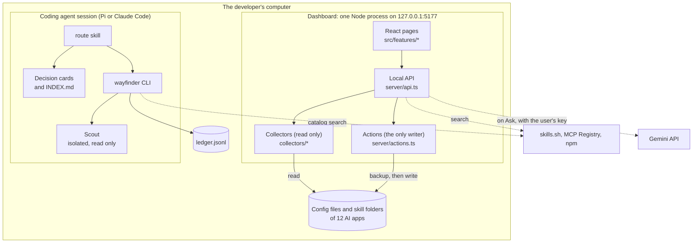
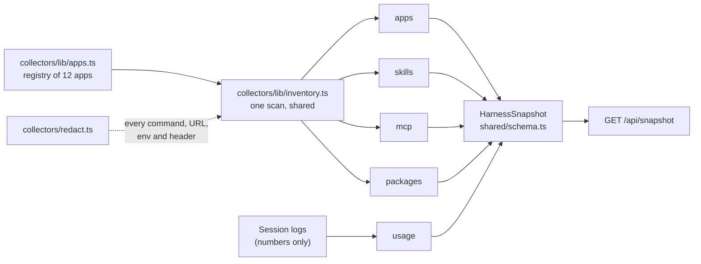
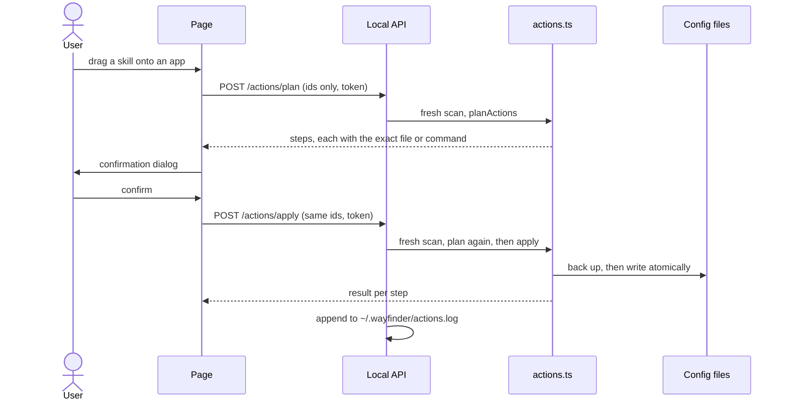
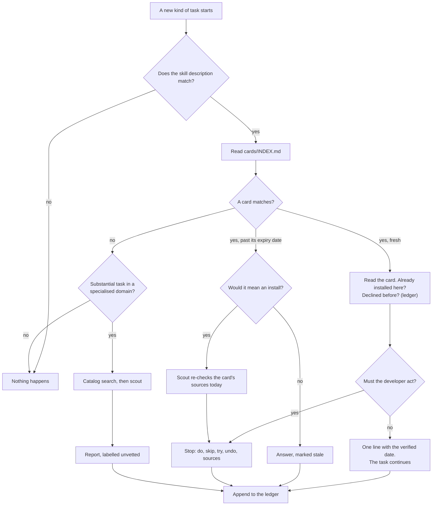

# Architecture

How Skillhub is built, as it stands in the code on 2026-11-14. The two specs ([`spec.md`](spec.md), [`dashboard-spec.md`](dashboard-spec.md)) record how the design was reached, amendment by amendment. This file is the short version of where it ended up, with a pointer to the code for every claim.

Naming: the product is Skillhub. Its in-session router was built under the working name `wayfinder`, which is still in commands, package names and paths.

## 1. The system in one page

Skillhub has two parts. They share one rule: use what already exists before adding anything, and never change a developer's setup without being asked.

| Part | Runs | Job |
| :- | :- | :- |
| **Dashboard** ([`dashboard/`](../dashboard/)) | As a local web page, outside any agent session | Shows which AI apps are on the computer, which skills and MCP servers each one has, what they cost in tokens, and what is missing. Can connect, disconnect or install after a confirmation |
| **Router** ([`pi-package/`](../pi-package/) for Pi, [`plugin/`](../plugin/) for Claude Code) | Inside the coding agent | When a new kind of task starts, answers from a small set of dated decision cards: use this built-in feature, install this, or add nothing |

The two parts do not call each other. They meet in the files they both understand: the skill folders and MCP configs of the installed apps.

Size of the code, counted from tracked files:

| Area | Lines | Language |
| :- | :- | :- |
| `dashboard/src` (pages, shell, styles) | 6,256 | TypeScript, CSS |
| `dashboard/collectors` | 1,905 | TypeScript |
| `dashboard/server` | 1,782 | TypeScript |
| `dashboard/shared` | 601 | TypeScript |
| `dashboard/tests` | 823 | TypeScript |
| `pi-package` extension and CLI | 701 | TypeScript, Python |
| `plugin` CLI | 210 | Python |
| `tools` and `tests` | 1,492 | Python |

Sixteen decision cards (12 for Pi, 4 for Claude Code) and 30 eval cases are Markdown.

## 2. Dashboard

### 2.1 One process

`npm run dev` starts Vite. A small plugin in [`vite.config.ts`](../dashboard/vite.config.ts) mounts the API under `/api` on the same server, so there is one process, one port and no CORS. The server code is loaded through Vite (`ssrLoadModule`), which is what lets collectors be discovered with `import.meta.glob` on the server exactly as tabs are in the browser.

The server binds to `127.0.0.1`. There is no production server: the dashboard is a local tool and is run with `dev` or `demo`.

### 2.2 Reading: collectors and the snapshot

- **The app registry is data.** [`collectors/lib/apps.ts`](../dashboard/collectors/lib/apps.ts) lists, for each of twelve apps, the paths that prove it is installed, its skill folders and its MCP config files. Supporting a new app is an entry there, not new code.
- **One collector per slice.** [`collectors/index.ts`](../dashboard/collectors/index.ts) discovers every `collectors/<id>.ts` and gives each one key under `slices`. A collector that throws leaves an empty slice and a warning. One broken config never blanks the page.
- **Identity across apps.** Every skill and server carries a `key`: the same name and description for a skill, the same endpoint or launch package for a server. The map, the "shared by" counts and the sync suggestions are all built on it. This is what turns twelve separate lists into one picture.
- **Redaction at the source.** Everything a collector emits about a command, a URL, an env map or a header map passes through [`collectors/redact.ts`](../dashboard/collectors/redact.ts) first. Values are dropped and names kept. Nothing downstream has a secret to leak.
- **Derived facts are computed, not generated.** Topic tags come from keyword matching ([`shared/tags.ts`](../dashboard/shared/tags.ts)); findings such as "Codex is missing one of your skills" come from comparing keys ([`shared/insights.ts`](../dashboard/shared/insights.ts)). No model is involved in scanning or in findings.

### 2.3 Writing: plan, confirm, apply

The first design was strictly read-only. It was relaxed in one narrow way: a change can be carried out after the user confirms a plan that names the exact file or command. All of it lives in [`server/actions.ts`](../dashboard/server/actions.ts), and nothing else writes.

What makes this safe to offer:

| Rule | How it is enforced |
| :- | :- |
| A request cannot aim a write at an arbitrary file | Requests carry snapshot ids. Paths and commands are derived on the server |
| The plan the user saw is the plan that runs | The server rescans and plans again at apply time |
| Nothing is lost | A config is copied to `~/.wayfinder/backups/` before it is edited and written atomically. A skill folder is moved there, never deleted |
| A file is never mangled | A config with comments is not rewritten. The step is refused and the manual snippet shown. Codex's TOML is parsed again with the new section before it is written |
| No command injection | Processes start without a shell, and only `claude`, `codex` and `npx`. Registry names and addresses must match a strict pattern: no leading dash, no shell characters, `https` only |
| Credentials stay on disk | Copied from one config to another when asked, and absent from the plan, the result, every HTTP response and the log |
| Another website cannot trigger a change | See 2.5 |

### 2.4 Where a model is used, and where it is not

| Task | Done by |
| :- | :- |
| Finding apps, skills, servers, usage | Deterministic collectors |
| Tags, findings, suggested fixes | Deterministic code in `shared/` |
| Search and suggestions | Public registries, ranked by their own install counts |
| Explaining the result in plain words | Gemini, optional, on Ask |
| Turning "add my design skills to Cursor" into a proposed plan | Gemini chooses; the server plans; the user confirms |

Gemini is given the setup as a short text with ids such as `S3` and `M1`, and may return only: operations from a fixed list of six, a map view, or a search phrase ([`server/command.ts`](../dashboard/server/command.ts)). The server resolves the ids against the scan, drops anything that does not resolve, and plans with the same code as a manual action. The model cannot name a path or a command, and the route that talks to it cannot apply anything.

### 2.5 Trust boundaries

| Threat | Mitigation | Where |
| :- | :- | :- |
| Another site in the browser calls the local API | Bound to `127.0.0.1`; `Host` and `Origin` must be local | `server/api.ts`, `isLocalRequest` |
| Another site triggers a change | Write routes need a JSON body, an `Origin` header and a per-start token that only a same-origin page can read | `server/api.ts`, `vite.config.ts` |
| A secret in a config reaches the page or a model | Redaction in the collectors; tests plant fake credentials in an invented home folder and assert none appears in the snapshot, a plan or a prompt | `collectors/redact.ts`, `tests/collectors/` |
| A registry listing or skill description carries instructions | Third-party text is rendered as plain text, and labelled as data in every prompt that includes it | `server/gemini.ts`, `server/command.ts`, `pi-package/agents/scout.md` |
| A registry entry smuggles a flag or shell syntax into a command | Strict patterns on names, repositories and addresses; no shell | `server/actions.ts`, `server/discover.ts` |
| Private conversation text is read | Only token counts, model, date and project folder name are taken from session logs | `collectors/usage.ts` |

What leaves the machine, and when:

| Destination | Trigger | Content |
| :- | :- | :- |
| skills.sh | Opening Explore; a search | One-word topics; the search text |
| MCP Registry, npm | A search | The search text |
| Gemini | Pressing Ask or Send, with the user's own key | Names of apps, skills, servers and plugins, skill descriptions, token totals, project folder names |

Nothing else. There is no telemetry and no Skillhub server.

### 2.6 Built for two people and their agents

The dashboard was written by two developers working at the same time, each with a coding agent. The layout exists to make that conflict-free:

- A tab is `src/features/<id>/feature.tsx`, a collector is `collectors/<id>.ts`, and both are discovered automatically. Adding one never edits a shared file.
- Styles and tests live next to the feature. Nobody appends to a shared stylesheet or test file.
- The shared files (schema, shell, collector index, `package.json`) are a protected "spine", changed only in small dedicated pull requests.

The rules are in [`dashboard/CLAUDE.md`](../dashboard/CLAUDE.md), written for the agents as much as for the people.

## 3. Router

### 3.1 The idea

A developer cannot follow every plugin, skill, MCP server and working method. Existing recommenders start from the repository, rank by popularity and always return something. The router starts from the task, keeps a dated verdict per situation, and treats "you need nothing" as a first-class answer. The reasoning is in [`design-brief.md`](design-brief.md) and the survey of what already exists in [`prior-art.md`](prior-art.md).

### 3.2 Flow

### 3.3 Decision cards as a dated cache

A card is one Markdown file: a symptom in the developer's words, one verdict, at most one alternative, a list of what to skip and why, the install and undo commands, source links, the date it was verified and how long it stays fresh. The schema is checked by [`tools/cards.py`](../tools/cards.py) and summarised in [`api-reference.md`](api-reference.md#62-decision-card).

- **Cards expire.** `verified` plus `ttl_days` gives an expiry date: 90 days for built-in answers, 30 for a third-party pick. A stale card that would mean an install is re-checked against its own sources before it is used.
- **The index is generated.** The router reads `INDEX.md` first and compares two dates. It does no date arithmetic and reads only the one card it needs.
- **The harness-neutral idea is kept apart from the recipe.** Each card has a `## Pattern` section with no product names and a `## Pi recipe` or `## Claude Code recipe` section. That is what let the first four cards be ported from Claude Code to Pi with a different answer where the harness differs: planning is built into Claude Code and is a package in Pi.
- **If curation stops, it degrades honestly.** Stale cards say they are stale, and uncovered tasks fall back to a rubric-guided lookup labelled unvetted.

### 3.4 Cost: under 300 tokens, measured

The skill's description is the only text always in the model's context: 954 of 1,024 characters, about 282 tokens with twelve cards (`python3 tools/pi_eval.py --measure`). Everything else loads on demand.

- The `/wayfinder` command and the `--no-wayfinder` flag cost no model tokens.
- The three tools are registered with `exposure: "deferred"`, so they are absent from the active tool list until something asks for them.
- The skill's main path uses only file reads. The shell appears only in the optional ledger and lookup steps, so the router still works where a shell is not allowed.

### 3.5 The live lookup is isolated

When no card covers a substantial task, the CLI searches the npm registry for Pi packages and then starts a scout: a second `pi` process with no session, no skills, no context files, the edit and write tools removed, and a fixed system prompt ([`agents/scout.md`](../pi-package/agents/scout.md)). It judges candidates with seven rubric questions and reports at most three, with a line for anything it could not verify and a line for any text that tried to instruct it.

The scout reads untrusted pages, which is why it cannot write and why its output is never worded as a verdict.

### 3.6 The ledger closes the loop

Every recommendation, adoption, refusal and miss is one line in a local `ledger.jsonl`. It stops the router from pitching what was already declined, and `wayfinder ledger misses` lists the tasks no card covered, most frequent first. Those are the cards to write next.

### 3.7 Off switches

| Scope | How |
| :- | :- |
| A whole project, nothing in context | A package filter in `.pi/settings.json`, or `pi config --local` |
| One session, manual only | `pi --no-wayfinder`, or `/wayfinder off` |
| Claude Code, one project | `claude plugin disable wayfinder@agentic-dev-tools --scope local` |

## 4. How it is verified

| What | How | Count | Runs |
| :- | :- | :- | :- |
| Card schema, index and fixtures | `python3 tools/cards.py check` | 16 cards | CI, every push |
| Card tooling, ledger, catalog ranking, eval parser | `python3 -m unittest discover tests` | 54 tests | CI, every push |
| Collectors, redaction, actions, assistant commands | `cd dashboard && npm test` | 51 tests | Locally |
| Types | `cd dashboard && npm run typecheck` | | Locally |
| Always-on cost | `python3 tools/pi_eval.py --measure` | about 282 tokens | Locally, no model call |
| Routing quality | Eval cases, with and without the package | 19 for Pi, 11 for Claude Code | Locally; real model calls |

Two points on method:

- **The dashboard is tested against an invented machine.** [`tests/helpers/fixture-home.ts`](../dashboard/tests/helpers/fixture-home.ts) builds a throwaway home folder with several apps installed and fake credentials planted in their configs. The tests then prove what never appears in output, and that an action does nothing until it is applied. The same fixture produces the demo data, and a test fails when the two drift apart.
- **The router is measured against the bare model.** Each eval case runs with the package and without it. Graders are regular expressions and tool-call checks, never a judge model. Three cases in each suite assert that the router stays silent on small tasks. The Claude Code baseline is in [`plugin/evals/BASELINE.md`](../plugin/evals/BASELINE.md): the router fired in 24 of 24 routing runs and in 0 of 9 must-not-trigger runs, and the largest gains were on the two domain cards, where the bare model never names the tool.

## 5. Decisions and their trade-offs

| Decision | Why | Cost |
| :- | :- | :- |
| No hosted index or backend | Catalogs of hundreds of thousands of entries already exist; another list is what causes the problem | Search quality is whatever the public registries return |
| A few dated cards instead of a catalog | One opinionated, checkable answer removes doubt; a ranking does not | Cards must be kept current by hand until the curator exists |
| Never install automatically | Third-party skills and servers run with the developer's permissions | One more step for the developer |
| Run the dashboard through Vite's dev server | One process, auto-discovery on both sides, nothing to deploy | Not packaged as a standalone binary |
| Link a skill into another app instead of copying | One copy to edit | Every app that links to it loses the skill if the original folder goes |
| Gemini over plain HTTP, no SDK | Two calls with a fixed response schema; one fewer dependency | Request shape maintained by hand |
| The router's CLI in standard-library Python | Runs wherever the agent runs, with no install step | Two languages in the repository |

## 6. What is not built

- **Dashboard:** turning plugins on or off, project-scoped MCP config, anything held in a cloud account (ChatGPT connectors, claude.ai connectors), and the `configs` and `cards-ledger` tabs from the first spec. Gemini CLI, opencode, Windsurf and Zed paths follow documentation and were not checked on a machine that has them.
- **Router:** the weekly digest of new tools (Radar), the scheduled curator that re-verifies stale cards and opens a pull request, and Prune, which would point at installed tools a card now says are built in. They are outlined in [`spec.md`, section 10](spec.md#10-later-phases-outline).
- **CI:** the dashboard's tests and type check run locally and are not yet in the workflow.
- **Platforms:** app logos are read from macOS app bundles (`.icns`). On other platforms an app gets a monogram in its identity colour.
